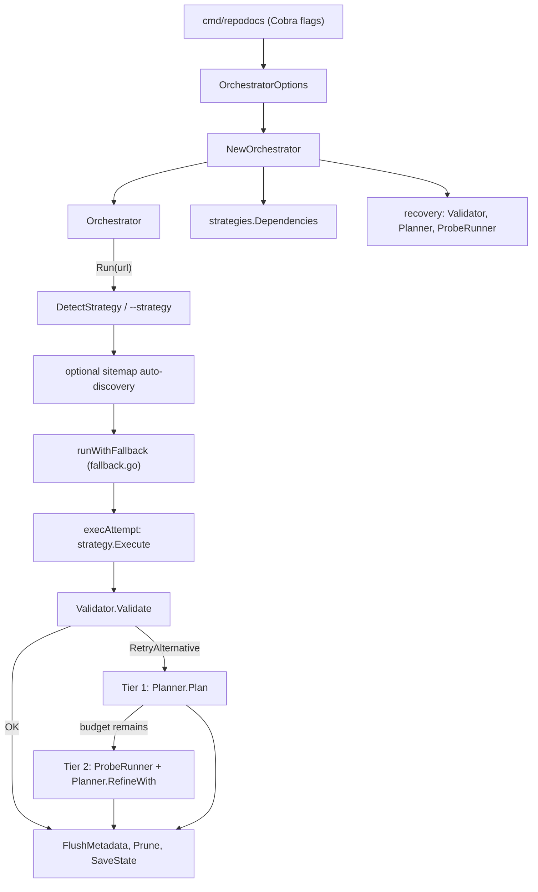

# Architecture Overview

RepoDocs is a layered, interface-driven Go application. The CLI assembles an
[`Orchestrator`](#orchestrator), which wires shared
[dependencies](#shared-dependencies) into a chosen
[strategy](strategies.md), runs it, validates the outcome through
the [recovery pipeline](../workflows/self-healing.md), and persists documents
through a shared [extraction pipeline](../workflows/extraction-pipeline.md).

## Layers

| Layer | Package(s) | Role |
| :--- | :--- | :--- |
| **CLI** | `cmd/repodocs` | Cobra command tree (`run`, `doctor`, `version`, `config`), flag parsing, Viper binding, signal handling |
| **Application** | `internal/app` | [Orchestrator](#orchestrator), [URL detection](strategies.md#detection-cascade), [fallback loop](../workflows/self-healing.md) |
| **Strategies** | `internal/strategies`, `internal/strategies/git` | Per-source extractors implementing `domain.Strategy` |
| **Recovery** | `internal/recovery` | Outcome validation, fallback planning, diagnostic probes |
| **Domain** | `internal/domain` | Interfaces (`Strategy`, `Fetcher`, `Renderer`, `Cache`, `Converter`, `Writer`, `LLMProvider`), models, errors |
| **Subsystems** | `internal/{fetcher,renderer,converter,cache,llm,output,state,manifest,git,tui,utils}` | Concrete implementations of the domain interfaces |
| **Config** | `internal/config` | Viper loading, defaults, proxy resolution |

The domain package declares the contracts; everything else either consumes or
implements them. Strategies never import concrete subsystem packages directly —
they receive a shared `*strategies.Dependencies` bag constructed by the
orchestrator.

## Orchestrator

The `Orchestrator` (`internal/app/orchestrator.go`) is the single wiring point
for a run. `NewOrchestrator(opts)` resolves the proxy, expands the cache
directory, builds the `strategies.Dependencies`, installs a pluggable
`strategyFactory` (default `detector.CreateStrategy`), and instantiates the
three recovery collaborators (`Validator`, `Planner`, `ProbeRunner`).

`Run(ctx, url, opts)` is the main single-URL flow:

1. Resolve the strategy — explicit `--strategy` override, otherwise
   `DetectStrategy(url)`. For a detected crawler, optionally auto-discover a
   sitemap (`strategies.DiscoverSitemap`) and switch to the sitemap strategy.
2. Delegate to `runWithFallback` (`internal/app/fallback.go`), which executes
   the attempt, validates it, and retries alternatives when the outcome is
   insufficient (see [Self-healing pipeline](../workflows/self-healing.md)).
3. Interpret the recovery verdict: `OK` proceeds, `Propagate` returns the
   transient cause, `RetryAlternative`/`HardFail` returns a formatted
   `OutcomeError`.
4. Flush metadata, optionally prune deleted files (`--prune`), and save sync
   state.

`RunManifest` processes a batch manifest with a worker pool (concurrency capped
to 3 for manifests), continuing or failing fast based on `continue_on_error`.

The orchestrator single-URL flow, from CLI flags through strategy execution and recovery to output finalization.

## Shared dependencies

`strategies.Dependencies` (`internal/strategies/strategy.go`) is the service bag
every strategy receives. It is constructed once and shared, so a single cache,
fetcher, renderer, converter, and writer serve all strategies and fallback
attempts. Key fields and their implementations:

| Field (interface) | Implementation | Notes |
| :--- | :--- | :--- |
| `Fetcher` (`domain.Fetcher`) | `fetcher.Client` | Stealth TLS client with retries, caching, 403→renderer fallback |
| `Renderer` (`domain.Renderer`) | `renderer.Renderer` | Lazy headless Chromium via go-rod (`GetRenderer()`, single `sync.Once`) |
| `Cache` (`domain.Cache`) | `cache.BadgerCache` | BadgerDB v4 with background GC |
| `Converter` (`domain.Converter`) | `converter.Pipeline` | Sanitize → extract → convert to Markdown |
| `Writer` (`domain.Writer`) | `output.Writer` | Markdown + frontmatter, optional JSON metadata collector |
| `LLMProvider` (`domain.LLMProvider`) | `llm.RateLimitedProvider` | Wraps a provider in rate limiter + circuit breaker + retrier |
| `MetadataEnhancer` | `llm.MetadataEnhancer` | Optional summary/tags/category generation |
| `StateManager` | `state.Manager` | Incremental sync state (`-sync`, `-prune`) |
| `HTTPClient` | (transport from fetcher) | Used by Colly in the crawler |
| `Collector` | `output.MetadataCollector` | Accumulates `metadata.json` entries |

The `Dependencies.WriteDocument(ctx, *domain.Document)` helper is the canonical
write path: it enhances metadata, writes the file, and records sync state.
Strategies call it rather than writing directly. See
[Extraction pipeline](../workflows/extraction-pipeline.md) for how a single
document flows through these.

## Component map

| Component | Location | Responsibility |
| :--- | :--- | :--- |
| Detector | `internal/app/detector.go` | `DetectStrategy` URL routing, `CreateStrategy` factory |
| Orchestrator | `internal/app/orchestrator.go` | Wiring, single-URL and manifest runs |
| Fallback loop | `internal/app/fallback.go` | `runWithFallback`, bounded retry with dedup |
| Strategies | `internal/strategies/` | Eight source-specific extractors |
| Git strategy | `internal/strategies/git/` | URL parsing, archive/clone fetch, file processing |
| Fetcher | `internal/fetcher/` | TLS-mimicking HTTP client, retries, stealth transport |
| Renderer | `internal/renderer/` | Headless Chromium, tab pool, CDP sidecar, proxy auth |
| Converter | `internal/converter/` | HTML→Markdown, RST→Markdown, content extraction |
| Cache | `internal/cache/` | BadgerDB persistent cache, key generation |
| LLM | `internal/llm/` | Provider factory, resilience wrappers, metadata |
| Output | `internal/output/` | Markdown writer, metadata collector |
| State | `internal/state/` | Incremental sync state |
| Manifest | `internal/manifest/` | Batch manifest loading/validation |
| Git client | `internal/git/` | Injectable go-git wrapper |
| TUI | `internal/tui/` | Bubble Tea/Huh config editor |
| Utils | `internal/utils/` | URL/FS helpers, logger, progress, worker pool |
| Config | `internal/config/` | Viper loading, defaults, proxy resolution |

See [Source map](../source-map.md) for the full directory listing with roles.

## Design principles

- **Interface-driven.** Subsystems implement small `domain.*` interfaces, so
  strategies depend on contracts, not concrete packages. This keeps the strategy
  layer testable with mocks (see [Testing guide](../testing.md)).
- **Single wiring point.** All dependencies are assembled in
  `NewOrchestrator`; strategies never construct their own fetcher/cache/renderer.
- **Bounded recovery.** Self-healing is capped at three total executions per URL
  (initial + two fallbacks), deduplicated by `(strategy, url, filter)`, and
  suppressed when the user forces a strategy or passes `--no-fallback`.
- **Lazy resources.** The Chromium renderer initializes on first use; the cache
  may be in-memory or on-disk.
- **Consistent telemetry.** Every `Execute` returns a `StrategyResult` populated
  even on partial failure, so validation and diagnostics are uniform. See
  [Domain data model](../domain/data-model.md).
