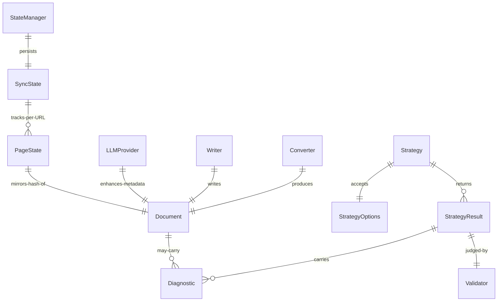

# Domain Data Model

The `internal/domain/` package is the contract layer: it declares the interfaces
strategies depend on, the models that flow between layers, the structured result
each strategy returns, and the error types that drive retry and recovery. Nothing
in `domain` imports a concrete subsystem — see
[Architecture overview](../architecture/overview.md#layers).

## Entity relationships

Core domain entities and how a strategy result relates to validation, and a document relates to conversion, output, and sync state.

## Document

`Document` (`internal/domain/models.go`) is the unit of extracted content. A
strategy/convert path produces it and the [output writer](../workflows/extraction-pipeline.md#output-writer)
persists it. Notable fields:

| Field | Purpose |
| :--- | :--- |
| `URL`, `Title`, `Description` | Source identity and human metadata |
| `Content` | Markdown body (excluded from JSON with `json:"-"`) |
| `HTMLContent` | Original HTML (excluded from JSON) |
| `ContentHash` | SHA256, used by sync state to detect changes |
| `WordCount`, `CharCount` | Length stats |
| `Links`, `Headers` | Extracted anchors and heading outline |
| `RenderedWithJS`, `CacheHit`, `SourceStrategy` | Provenance flags |
| `Summary`, `Tags`, `Category` | Optional LLM-enhanced metadata |
| `IsRawFile`, `RelativePath` | Output-path hints (excluded from JSON) |

Related raw types: `Page` (a fetched page before conversion), `CacheEntry`
(cached entry with expiry), `Sitemap`/`SitemapURL`, `LLMSLink`, and `Frontmatter`
(YAML frontmatter written to Markdown files).

## StrategyResult

`StrategyResult` (`internal/domain/strategy_result.go`) is the structured outcome
every `Execute` returns. It is populated even on partial failure so the
[Validator](../workflows/self-healing.md#verdicts) and user-facing diagnostics
work uniformly. Counters are mutex-guarded and nil-safe; `Snapshot()` returns a
lock-free immutable copy.

| Counter | Meaning |
| :--- | :--- |
| `URLsDiscovered` | URLs the strategy found |
| `URLsAttempted` | URLs that cleared the limit gate and were processed |
| `DocsWritten` | Documents successfully written |
| `DocsSkipped` | Documents skipped (exists, unchanged via sync, or dry-run) |
| `DocsFailed` | Documents that failed during processing |
| `BytesWritten` | Total bytes written |
| `Diagnostics` | Machine-readable outcome signals (see below) |

`CompletedDocs()` is `DocsWritten + DocsSkipped` — both count as acceptable
output. Invariant: `attempted ≈ written + skipped + failed`.

### Diagnostic codes

`Diagnostic{Code, Message, Hint}` carries a machine-readable signal. Defined
`DiagnosticCode` constants:

| Code | When emitted |
| :--- | :--- |
| `filter_zeroed` | A path filter excluded all candidate URLs |
| `sitemap_shallow` | Sitemap discovered few URLs before filtering |
| `all_fetches_failed` | Every fetch attempt failed |
| `all_fetches_blocked` | Every fetch was blocked (e.g. Cloudflare) |
| `empty_content` | Fetched content was empty |
| `redirect_loop` | A redirect loop was detected |
| `js_required` | The page appears to require JavaScript |
| `no_documents` | No documents were produced |

These map directly to the validator's `RetryAlternative` triggers
(`filter_zeroed`, `no_urls_attempted`) and to `OutcomeError` suggestions.

## SyncState

`internal/state/models.go` defines the incremental-sync schema, persisted to
`.repodocs-state.json`:

- `SyncState{Version, SourceURL, Strategy, LastSync, Pages map[string]PageState}`
  — `StateVersion = 1` (versioned for forward migration).
- `PageState{ContentHash, FetchedAt, FilePath}` — keyed by page URL.

`ShouldProcess(url, contentHash)` compares the stored hash to the current one;
`GetDeletedPages()` diffs the current run's seen URLs against stored pages for
pruning. See [Extraction pipeline: sync state](../workflows/extraction-pipeline.md#sync-state).

## Error hierarchy

`internal/domain/errors.go` defines sentinel errors and typed error structs that
the fetcher, LLM layer, and [recovery pipeline](../workflows/self-healing.md)
classify uniformly:

- **Sentinels**: `ErrNotFound`, `ErrCacheMiss`, `ErrCacheExpired`, `ErrRateLimited`,
  `ErrBlocked`, `ErrTimeout`, `ErrInvalidURL`, `ErrNoStrategy`, `ErrRenderFailed`,
  `ErrConversionFailed`, `ErrWriteFailed`, `ErrBrowserNotFound`,
  `ErrInsufficientOutput`, `ErrPlanExhausted`.
- **Typed errors**: `FetchError{URL, StatusCode, Err}`, `RetryableError`,
  `LLMError`, `StrategyError`.

`IsRetryable(err)` and `IsTransient(err)` predicates drive retry (fetcher, LLM)
and recovery (propagate vs. hard-fail) decisions. The validator returns
`VerdictPropagate` for transient errors (left to the fetch-layer backoff) and
`VerdictHardFail` for non-transient ones.

## Interface contracts

`internal/domain/interfaces.go` declares the small interfaces every subsystem
implements — `Strategy`, `Fetcher`, `Renderer`, `Cache`, `Converter`, `Writer`,
`LLMProvider` — plus the `Response`, `RenderOptions`, `LLMRequest`, and
`LLMResponse` value types. Keeping these in `domain` is what lets strategies
depend on contracts and be tested with generated mocks (see
[Testing guide](../testing.md)).
