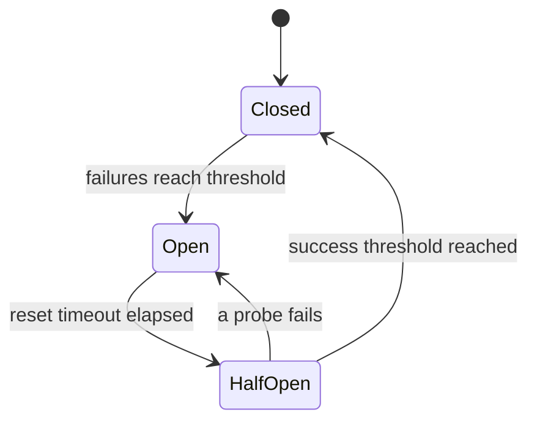

# LLM Integration

LLM integration is an optional metadata-enrichment layer. When enabled, RepoDocs
asks a configured provider to generate a `summary`, `tags`, and `category` for
each document, stored alongside the extracted Markdown and surfaced in the JSON
metadata index. All provider implementations are in `internal/llm/`.

## Enabling enrichment

Set `llm.enhance_metadata: true` in config, or rely on `--json-meta` (which
implies collection). Configure a provider under `llm:` in
`configs/config.yaml.template` (API keys via `REPODOCS_LLM_API_KEY`, never in the
file). See [Operations runbook: LLM metadata enhancement](../operations/runbook.md#llm-metadata-enhancement)
for provider-specific setup.

## Providers

Each provider implements `domain.LLMProvider` (`Name`, `Complete`, `Close`)
and is constructed by the `NewProvider`/`NewProviderFromConfig` factory
(`provider.go`).

| Provider | File | Wire format | Default base URL |
| :--- | :--- | :--- | :--- |
| OpenAI | `openai.go` | OpenAI chat-completions | `https://api.openai.com/v1` |
| Anthropic | `anthropic.go` | `system` + `messages`, version `2023-06-01` | `https://api.anthropic.com/v1` |
| Google Gemini | `google.go` | `contents`/`systemInstruction`/`generationConfig` | `generativelanguage.googleapis.com` |
| Ollama | `ollama.go` | `messages`/`options`, `stream:false` | `localhost:11434` |
| LM Studio | `lmstudio.go` | OpenAI chat-completions (no auth when key empty) | `localhost:1234/v1` (300s timeout) |

`NewProviderFromConfig` validates the API key (skipped for Ollama/LMStudio),
model, and base URL before constructing the provider. LM Studio gets a 300s
default timeout because local inference is slow.

## Resilience stack

`RateLimitedProvider` (`provider_wrapper.go`) wraps any provider with three
layers. The ordering in `Complete` matters:

1. **Circuit breaker** `Allow()` — checked *before* consuming a rate-limit token,
   so an open breaker does not drain the bucket.
2. **Retrier** (`retry.go`) — wraps `cenkalti/backoff/v4`; retries `url.Error`
   timeouts, `ErrLLMRateLimited`, and status codes 429/500/502/503/504. Does not
   retry `context.Canceled`/`DeadlineExceeded`. Backoff is
   `InitialInterval × Multiplier^attempt ± jitter`, capped at `MaxInterval`.
3. **Per-attempt rate limit** — a `TokenBucket` `Wait` (`ratelimit.go`) runs
   *inside* the retry loop, so retries count against the limit. Success/failure
   is recorded on the breaker after each attempt.

### Circuit breaker states

Circuit breaker lifecycle around an LLM provider: closed by default, opens after the failure threshold, probes in half-open, resets on success.

- **Closed** → **Open** after `failure_threshold` (default 5) failures.
- **Open** → **HalfOpen** after `reset_timeout` (default 30s); in half-open, at
  most `success_threshold_half_open` (default 1) concurrent probes run.
- **HalfOpen** → **Closed** once the success threshold is met; any probe failure
  re-opens the breaker.

## Metadata enhancement flow

`MetadataEnhancer` (`metadata.go`) does the actual enrichment:

1. Truncates document content to 8000 characters.
2. Sends a system prompt forcing JSON-only output with a `Complete` call.
3. Parses the response with `extractJSON` (tries raw → stripped code fences →
   brace-matching), extracting `{summary, tags, category}`.
4. On parse failure, retries up to 2 times with a simplified retry prompt.

The enhanced fields (`Summary`, `Tags`, `Category`) are written into the
`Document` (see [Domain data model](../domain/data-model.md#document)) and
flow into the output writer and JSON metadata index.

## Where this is tested

- `internal/llm/{provider_wrapper,retry,circuit_breaker,ratelimit}_test.go` —
  resilience-stack behavior (the retry jitter fix in commit `15df462` added
  regression tests for known backoff bugs).
- `tests/integration/llm/` — provider integration.
- `tests/unit/llm/` — unit tests per provider.

See [Testing guide](../testing.md).
