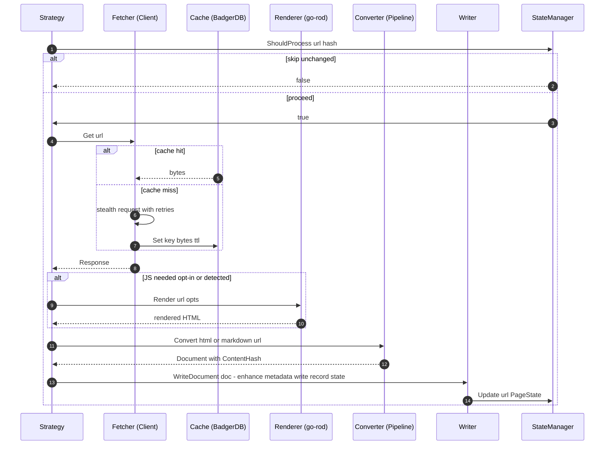

# Extraction Pipeline

Strategies discover URLs, then process each one through a shared pipeline of
subsystems. This page follows a single document from fetch to write, and
explains the [caching](#cache), [rendering](#renderer), [conversion](#converter),
[output](#output-writer), and [sync-state](#sync-state) layers. Strategies call
`Dependencies.WriteDocument` rather than wiring these directly — see
[Architecture overview](../architecture/overview.md#shared-dependencies).

## End-to-end flow

A single document flowing through fetch (cached), optional render, convert, and write, gated by incremental sync state.

The exact branching (Markdown vs HTML, JS render or not) is strategy-specific;
see [Extraction strategies](../architecture/strategies.md). The crawler and sitemap strategies
share the most logic: content-type detection decides whether a response is
passed straight through (`MarkdownReader`/`PlaintextReader`) or through the
converter.

## Fetcher

`internal/fetcher/` implements `domain.Fetcher` with a stealth HTTP client.

- **TLS mimicry** (`client.go`): wraps `bogdanfinn/tls-client` with a Chrome 131
  profile, randomized TLS extension order, and browser-like headers
  (`StealthHeaders`, randomized `User-Agent`, `Accept-Language`, `Sec-CH-UA`).
- **Caching first**: `Get`/`GetWithHeaders` are cache-first; cache hits set
  `Response.FromCache = true`. Cache keys are generated centrally (see below).
- **Retries** (`retry.go`): wraps `cenkalti/backoff/v4` exponential backoff.
  `ShouldRetryStatus` retries 429, 502, 503, 504, and Cloudflare 520–530, and
  honors `Retry-After` via `ParseRetryAfter` when it exceeds the computed
  backoff.
- **403 → renderer fallback**: `StealthTransport` (a Colly-compatible
  `http.RoundTripper`) triggers an injectable `RendererFallback` when
  Cloudflare blocks the HTTP path, strips `Content-Encoding`, and bridges to
  Colly via `Transport()`.

`GetCookies(url)` exposes cookies so the renderer can share session state with
the fetcher.

## Cache

`internal/cache/` (`BadgerCache`) implements `domain.Cache` over BadgerDB v4.
On-disk by default (`~/.repodocs/cache`) or `InMemory`; spawns a background GC
goroutine running value-log GC every 5 minutes.

Keys are generated centrally in `keys.go`: `GenerateKey(rawURL)` is the SHA256
of a normalized URL. Normalization lowercases the host, strips default ports,
`path.Clean`s, removes the trailing slash (except root), and drops the fragment,
so equivalent URLs collide. Query strings are preserved. Prefix helpers
(`PageKey`, `SitemapKey`, `MetadataKey`) namespace entries. Cache control flags:
`--no-cache` disables the layer, `--refresh-cache` forces refresh, `--cache-ttl`
(default `24h`) sets the TTL.

## Renderer

`internal/renderer/` (`Renderer`) implements `domain.Renderer` with headless
Chromium via `go-rod` for JS-heavy/SPA sites.

- **Lazy and pooled**: `Dependencies.GetRenderer()` initializes the browser on
  first use (single `sync.Once`); a bounded `TabPool` (`pool.go`) recycles tabs
  (releasing a tab navigates it to `about:blank` to reset state).
- **Render flow**: acquire tab → apply stealth (`go-rod/stealth`, 1920×1080
  viewport, hide `navigator.webdriver`) → set cookies → navigate → `WaitLoad` →
  optional wait-for-selector / `WaitRequestIdle` / bounded `scrollToEnd` →
  return `page.HTML()`.
- **JS detection** (`detector.go`): `NeedsJSRendering(html)` detects
  React/Vue/Next/Nuxt/Angular/Svelte markers or "thin content + many scripts".
- **CDP sidecar** (`--cdp-endpoint`): connects to an externally managed browser.
  When set, `ownsBrowser=false`, so `Close()` leaves it running and proxy/stealth
  flags are delegated to the sidecar.
- **Proxy handling**: supports `http`/`https`/`socks5`/`socks5h` (mapping
  `socks5h`→`socks5` for Chrome to prevent IP leak). HTTP/HTTPS proxy
  credentials are handled via a persistent CDP `Fetch.Enable` auth handler that
  answers 407 challenges; SOCKS5 credentials are silently skipped (Chrome
  limitation).
- **Bounded lazy-load safety**: `scrollToEnd` is capped by
  `scrollToEndMaxIterations=10`, a 300ms pause, and a stable-height threshold of
  2 to avoid hanging on infinite-scroll pages. CI/GitHub Actions auto-enables
  `NoSandbox`.

See [Operations runbook](../operations/runbook.md) for proxy and CDP setup.

## Converter

`internal/converter/` (`Pipeline`) implements `domain.Converter`.

The HTML path (`pipeline.go`) is: UTF-8 conversion → parse once with goquery →
`PreserveCodeLanguages` (copies language info before extraction strips classes)
→ extract content → sanitize → convert to Markdown → build a `Document` with a
SHA256 `ContentHash`.

- **Content extraction** (`readability.go`): a CSS selector first, falling back
  to `go-shiori/go-readability` on `ErrSelectorNotFound`.
- **Sanitizer** (`sanitizer.go`): removes scripts/nav/ads/sidebar classes and
  resolves relative URLs.
- **Markdown** (`markdown.go`): uses `JohannesKaufmann/html-to-markdown/v2`
  (fenced code, ATX headings) with `cleanMarkdown` post-processing.
- **RST** (`rst.go`): a regex-driven state machine converting reStructuredText
  to Markdown (headings with adornment mapping, directives like `code-block`/
  admonitions/`image`, literal blocks, inline roles).
- **Content-type helpers** (`content_type.go`): `IsMarkdownContent`,
  `IsPlainTextContent`, `IsHTMLContent` decide per-response branching.
- **Non-HTML readers**: `MarkdownReader`/`PlaintextReader` handle already-Markdown
  or plain-text responses without conversion.

## Output writer

`internal/output/` (`Writer`) implements `domain.Writer`. `Write` computes the
output path (`GeneratePath`/`GeneratePathFromRelative`), skips existing files
unless `--force`, no-ops on `--dry-run`, ensures the directory, adds YAML
frontmatter via `converter.AddFrontmatter` (raw files bypass frontmatter), and
writes with mode 0644.

When `--json-meta` is set, a thread-safe `MetadataCollector` (`collector.go`)
accumulates `SimpleDocumentMetadata` and `Flush()` writes a `metadata.json`
index (generated-at, source URL, strategy, documents). `Dependencies.FlushMetadata`
is called by the orchestrator after a successful run.

## Sync state

`internal/state/` (`Manager`) provides incremental sync, written to
`.repodocs-state.json`. A versioned `SyncState` (`StateVersion=1`) maps page URLs
to `PageState{ContentHash, FetchedAt, FilePath}`.

- `ShouldProcess(url, contentHash)` is true when a page is new or its hash
  changed — strategies call it before fetching to skip unchanged pages (`--sync`).
- `Update(url, PageState)` records the current run's observed pages; `MarkSeen`
  tracks the run's URL set.
- `GetDeletedPages()` diffs the seen set against stored pages; the orchestrator
  calls `PruneDeletedFiles` with `--prune` to remove pages that disappeared
  upstream.
- `--full-sync` disables the manager (full re-processing); `Save` writes only
  when dirty.

See [Domain data model](../domain/data-model.md) for the `Document` and state
schemas.
