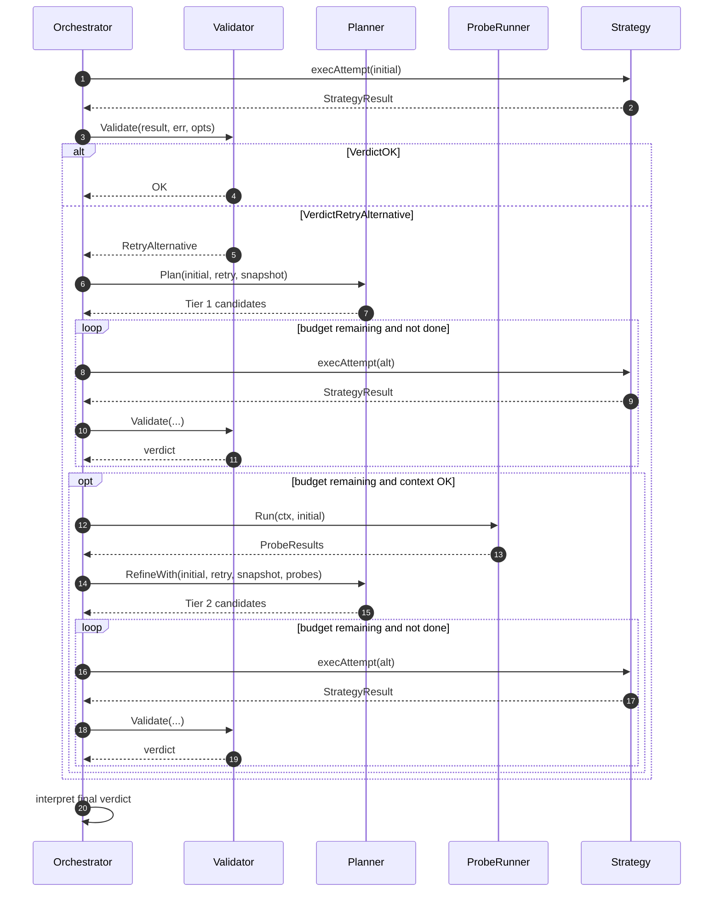

# Self-Healing Fallback Pipeline

When a strategy produces too little output, RepoDocs does not give up. The
orchestrator's `runWithFallback` loop (`internal/app/fallback.go`) validates the
outcome and retries with alternative strategies chosen by a two-tier planner.
This was built in phases (see git history): validation-only first, then static
fallback candidates, then probe-informed refinement.

The pipeline has three collaborators, all in `internal/recovery/`:

| Collaborator | File | Role |
| :--- | :--- | :--- |
| `Validator` | `validator.go` | Judges a `StrategyResult` + error into a `Verdict` |
| `Planner` | `planner.go` | Proposes alternative `Attempt`s (pure, no I/O) |
| `ProbeRunner` | `probes.go` | Runs cheap, bounded HTTP probes to refine the plan |

## Verdicts

`Validator.Validate(result, err, opts)` returns one of four verdicts:

| Verdict | Meaning | Orchestrator action |
| :--- | :--- | :--- |
| `VerdictOK` | Outcome satisfies criteria (enough docs, or dry-run with attempts) | Proceed to flush/prune/save |
| `VerdictPropagate` | Error is transient (managed by fetch-layer retry/backoff) | Return the cause, do not recover |
| `VerdictRetryAlternative` | Insufficient output but an alternative may succeed | Enter fallback loop |
| `VerdictHardFail` | Non-transient error or 0 completed docs with no viable alternative | Return a formatted `OutcomeError` |

Criteria default to `MinDocsWritten=1` and `MinSuccessRatio=0.10`, overridable
per run via `ValidationOptions` (driven by `--min-docs`). The `RetryAlternative`
triggers the validator recognizes are:

- **`filter_zeroed`** — `URLsAttempted == 0` with a non-empty `FilterURL` (the
  filter excluded every candidate URL).
- **`no_urls_attempted`** — `URLsDiscovered > 0` but `URLsAttempted == 0` (no
  filter in play; nothing survived limits).
- **`high_failure_ratio`** — over 20 attempted with a completed/attempted ratio
  below `MinSuccessRatio`.

The validator finishes the result's timer and reads a snapshot before deciding,
so verdicts are based on immutable counters.

## The fallback loop

`runWithFallback` runs the initial attempt, validates it, and only enters the
fallback loop when the verdict is `RetryAlternative`. Recovery is bounded by
`maxFallbackAttempts = 2` (initial + 2 fallbacks = 3 max executions) and
deduplicated by `attemptKey` (strategy + URL + filter) so the same attempt is
never re-run across tiers.

The two-tier self-healing loop: validate the initial attempt, try static planner candidates (Tier 1), then probe-informed candidates (Tier 2), each bounded and deduplicated.

`execAttempt` is the single execution path shared by the initial attempt and
all fallbacks: it resolves the strategy via the factory, sets source/strategy
attribution on the dependencies, assembles scoped `strategies.Options`, and
calls `strategy.Execute`. `tryFallback` executes one alternative and returns
`done=true` as soon as a verdict is `VerdictOK` (or the context is cancelled,
which yields `VerdictPropagate`).

## Tier 1 — static planner candidates

`Planner.Plan(failed, v, snap)` is pure and proposes candidates only for
zero-output triggers, which keeps fallback safe (the failed attempt wrote no
files, so re-running cannot conflict):

- **R1 (`filter_zeroed`)** — when a non-empty filter zeroed a non-crawler
  attempt, retry by crawling the filtered subtree directly, keeping the filter
  so the crawler stays scoped to that path.
- **R3 (`no_urls_attempted`)** — when a shallow/empty sitemap discovered URLs
  but attempted none (no filter), fall back to crawling the site origin.

The `high_failure_ratio` trigger is deliberately terminal: it may have written
partial output, so it yields no candidates.

## Tier 2 — probe-informed refinement ("Plan C")

If Tier 1 is exhausted with budget remaining, the orchestrator runs the
`ProbeRunner`, then asks `Planner.RefineWith(failed, v, snap, probes)` to map
successful probes to concrete attempts, ordered cheapest first:

1. **`llms.txt` on an ancestor path** → LLMS strategy on the discovered URL.
2. **Entry subtree exposes its own sitemap** → Sitemap strategy.
3. **Entry/origin looks like a link-rich index** → Crawler strategy.
4. **GitHub Pages site backed by a git repo** → Git clone (last resort).

The probes themselves (`internal/recovery/probes.go`) are bounded read-only HTTP
checks: each probe runs under a 2s timeout, the whole run under a 6s total
budget, with at most 4 ancestor probes. Probes run concurrently and share a
per-run `fetchCache` (`probe_cache.go`) so overlapping targets are fetched at
most once; the cache collapses concurrent in-flight fetches for the same URL
into one request.

`Planner.RefineWith` never re-proposes the failed strategy at the same URL, and
the caller deduplicates candidates already attempted in Tier 1.

## Suppression

Fallback is disabled when either:

- `--no-fallback` is set (`opts.NoFallback == true`), or
- `--strategy` (or a manifest `strategy`) is set
  (`opts.StrategyOverride != ""`) — explicit user intent should not be silently
  overridden.

In both cases `runWithFallback` returns the initial verdict without entering
the loop.

## Outcome errors

When recovery cannot rescue the run, `recovery.NewOutcomeError(verdict, result)`
(`errors.go`) formats a user-facing message with the strategy, entry URL,
discovered/attempted/written/skipped/failed counts, diagnostics, and
suggestions. It unwraps `VerdictHardFail.Cause` / `VerdictPropagate.Cause` so
`errors.Is`/`errors.As` chains still work. The orchestrator returns this for
`RetryAlternative` and `HardFail` verdicts.

## Where this is tested

- `tests/e2e/self_healing_test.go` — end-to-end fallback scenarios.
- `internal/recovery/{planner,probes,probe_cache}_test.go` — planner candidates
  and probe behavior.
- `internal/app/fallback_test.go` — the fallback loop and dedup/budget bounds.
- `tests/unit/recovery/validator_test.go` — verdict classification.

See [Testing guide](../testing.md) for how to run these.
